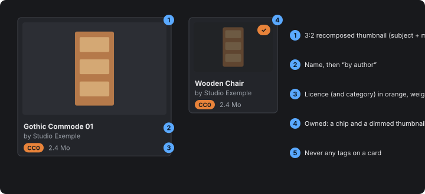
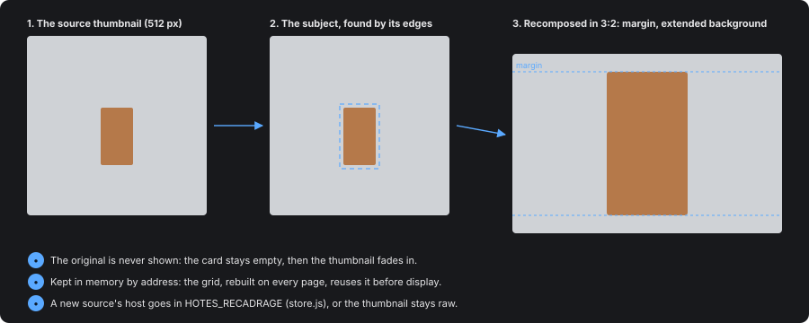

# Building a store

*[Version française](../fr/store-guide.md)*

> The rules shared by the model store and the texture store, settled through feedback (October
> 2026), so that a new store reuses them instead of rediscovering them. What each store knows about
> its sources (APIs, licences, breakdown) is in [asset-store.md](asset-store.md); colours, spacing
> and radii in the design system (`docs/design-system.html`). The mockups are **diagrams**: they
> show what goes where, not the pixels. They are regenerated with
> `node tools/store-guide-figures.mjs`.

## What lives where

| Role | Models | Textures |
|---|---|---|
| A source, with no requests (addresses, response translation, download plan) | `store-sketchfab.js`, `store-polyhaven.js` | `store-textures-polyhaven.js`, `store-textures-ambientcg.js` |
| The store on the main side: requests, bounded cache, IPC, storage | `store.js` | `store-textures.js` |
| What sources share: licences, `PAR_PAGE`, `memoireBornee` | `store-sources.js` | same |
| Classification (a table from the source to our categories) | `store-categories.js` | `texture-matieres.js` |
| The local library (“My …”, tags) | `bibliotheque-modeles.js` | `bibliotheque-textures.js` |
| The window | `src/store-ui.js` | `src/textures-store-ui.js` |
| Shared by the windows | `vignette-recadrage.js`, `menuFlottant` (store-ui.js), `liste-etiquettes.js`, `store-texts.js` (`phrasesLicence`), `texte-defilant.js` | same |

The main-side modules are in `electron/bibliotheque/`.

## The window

1. **A window of its own**, opened by its own header button with a line icon. Never a tab of
   another store (asked for textures).
2. **One tab per source**, then “My …”, the local library.
3. **Filters and search** reload the page. Text too long for its field scrolls on hover
   (`texte-defilant.js`, app-wide, drop-down menus included).
4. **The “Import” card** first in the grid, as tall as the others (`min-height` 120, no taller).
5. **The source credit**, clickable, below the grid, without repeating the licence; hidden on a
   detail page.
6. **24 results per page**, using the source's cursor (server-side paging when available). The
   next is requested near the bottom (`suiteADemander`), never while a detail page is open.

Context menus opened from a store or an editor sit above it (z-index 1100).

**“Choose” mode**: a store can open from where its resource is used (the texture square of the
Ground or a path). It opens “My …”, the use locked, the current resource marked; a click on a card
applies it and closes, downloading it first if needed. No “Import” card and no detail page in this
mode. What the application ships appears in “My …”, and cannot be deleted.

## The cards

1. **3:2 thumbnail** (taller than 16:9, shorter than square, which was tried and dropped),
   recomposed automatically (see below).
2. **The name**, then “by author”. A cut name scrolls on hover.
3. **Licence and category badges in orange** (a deliberate exception to the colour rule), then the
   **weight**, on “My …” cards too.
4. **Owned**: a chip, and a dimmed thumbnail (opacity 0.7).
5. **No tags** on a card: they are on the detail page.

## Thumbnails

Source thumbnails are made for their own site: a small object in a large background (Sketchfab), a
sphere touching the edges of a square (Poly Haven). So they are recomposed:

- **ask the source for its 512 px size**: 256 was blurry;
- **the recompose** (`src/vignette-recadrage.js`) finds the subject by its **edges**, not its
  colour, because a radial-gradient background differs everywhere from its corner colour. It
  enlarges it to fill the card minus a 10 % margin (×2.6 at most, beyond that it blurs), extends
  the background as a four-corner gradient and fades the image edges without ever reaching the
  subject;
- **the image's natural size**, never its displayed size: otherwise it is stretched;
- **a remote image's pixels** can only be read through the `store:vignette` IPC, limited to the
  hosts in `HOTES_RECADRAGE` (`store.js`). **A new source adds its hosts there**, or its
  thumbnails stay raw (contained, with a margin);
- **no flicker, no wait**: the original is never shown, the card stays empty then the thumbnail
  fades in. A finished thumbnail is kept by address (400 at most) and, since the grid is **rebuilt
  entirely on every page**, a returning card takes it back before being drawn (a
  `MutationObserver`), with no fade;
- textures shown **flat** (`.texture-a-plat`) are not recomposed: they cover the card.

## The detail page

The detail page replaces the grid, in two columns, the same for every store.

1. **On the left, the visual**, then its buttons: “View in 3D” (for a texture, round or flat,
   toggle at the top right) and “View on &lt;source&gt;”. No text under a button.
2. **On the right, the sections, always in this order**: *Used in this project*, *Licence* (the
   `phrasesLicence` sentences, then the link), *Characteristics*. Multiple choices (materials) in a
   `menuFlottant`, uses as tags, user tags with `remplirListeEtiquettes`. The source sets the order
   of the *Characteristics* lines.
3. **Weight last** in *Characteristics*. A state (grain, seam) only shows when it is a problem.
4. **In the footer, Back then the action**: “Download” (a split button for the resolution) or
   “Delete” once owned, never “Re-download”.

A detail page title is off the type scale, on purpose.

## Downloading and storing

- **Download only what the user picks**, nothing by default.
- **Only the useful resolution**: 1k by default, 2k on request, 4k only for the uses that justify
  it (buildings), never 8k.
- **All processing at download time** (grain baking, conversion), not at first use.
- **One folder per resource** under `<Projects>/<Type>/<source>-<id>/` and a JSON index for the
  local library. The renderer never provides a path: it gives an identifier, which the main
  process reads back.
- **Importing** from disk lands in “My …”, with an “unknown” licence and text saying so.

## Classifying

- **A pure table** from the source to our categories, tested. Several categories per resource are
  allowed.
- **The category dictates the use**, never the resource itself: that is what decides where the
  application offers it. A resource with none of our categories is dropped.
- **User tags** add to the source's classification, with their filter.

## Adding a source

1. **Check the API for real**: call it, keep a response as a fixture, note the date in
   [asset-store.md](asset-store.md). No key in the code.
2. **A module with no requests**: `idValide`, `urlRecherche(recherche)` (null when the filter can
   return nothing), `pageDepuis(json)` to `{ resultats, suivant }`, a normalisation to the common
   format (`source`, `id`, `nom`, `auteur`, `url`, `vignettes.petite/grande`, `licence`, `poids`,
   `details`), `planTelechargement` and `optionsTelechargement`. Download addresses checked by a
   strict expression.
3. **Tests on the recorded response**, and the source's tab (`SOURCES_STORE` in `store-ui.js` for
   models; `tests/store-onglets.test.mjs`).
4. **The thumbnail hosts** in `HOTES_RECADRAGE`.
5. **Credit and licence**: a clickable credit text, `phrasesLicence` for any new licence.

## Checklist for a new store

- [ ] A window of its own, line button in the header, alias in `modal-stack`.
- [ ] Tabs per source then “My …”, filters, next page near the bottom.
- [ ] `.store-carte` cards: 3:2, name, author, orange badges, weight, owned chip.
- [ ] 512 px thumbnails, hosts in `HOTES_RECADRAGE`, nothing else to do for the recompose.
- [ ] Detail page: visual and buttons on the left; Used, Licence, Characteristics on the right;
      Back and action in the footer; Delete once owned.
- [ ] Download on request, useful resolution, processing at download time.
- [ ] A pure, tested classification table; user tags.
- [ ] IPC channels declared in `preload.js` and `types/globals.d.ts`.
- [ ] Checked on screen, in all four themes.
