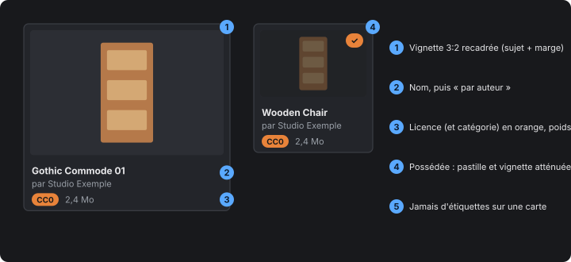
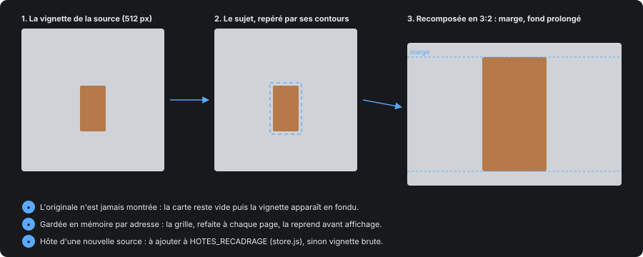

# Faire un store

*[English version](../en/store-guide.md)*

> Les règles communes au store de modèles et au store de textures, fixées au fil des retours
> (octobre 2026), pour qu'un nouveau store les reprenne sans les redécouvrir. Ce que chaque store
> sait de ses sources (API, licences, découpage) est dans [asset-store.md](asset-store.md) ; les
> couleurs, écarts et rayons dans le système de design (`docs/design-system.html`). Les maquettes
> sont des **schémas** : elles montrent ce qui va où, pas les pixels. Elles se refont avec
> `node tools/store-guide-figures.mjs`.

## Ce qui vit où

| Rôle | Modèles | Textures |
|---|---|---|
| Une source, sans requête (adresses, traduction des réponses, plan de téléchargement) | `store-sketchfab.js`, `store-polyhaven.js` | `store-textures-polyhaven.js`, `store-textures-ambientcg.js` |
| Le store côté principal : requêtes, mémoire bornée, IPC, rangement | `store.js` | `store-textures.js` |
| Ce qui est commun aux sources : licences, `PAR_PAGE`, `memoireBornee` | `store-sources.js` | idem |
| Le classement (table de la source vers nos catégories) | `store-categories.js` | `texture-matieres.js` |
| La bibliothèque locale (« Mes … », étiquettes) | `bibliotheque-modeles.js` | `bibliotheque-textures.js` |
| La fenêtre | `src/store-ui.js` | `src/textures-store-ui.js` |
| Partagé par les fenêtres | `vignette-recadrage.js`, `menuFlottant` (store-ui.js), `liste-etiquettes.js`, `store-texts.js` (`phrasesLicence`), `texte-defilant.js` | idem |

Les modules côté principal sont dans `electron/bibliotheque/`.

## La fenêtre

1. **Une fenêtre à part**, ouverte par son propre bouton du bandeau, à icône au trait. Jamais un
   onglet d'un autre store (demandé pour les textures).
2. **Un onglet par source**, puis « Mes … », la bibliothèque locale.
3. **Les filtres et la recherche** relancent la page. Un texte trop long pour son champ défile au
   survol (`texte-defilant.js`, pour toute l'application, menus déroulants compris).
4. **La carte « Importer »** en tête de la grille, à la hauteur des autres (`min-height` 120, pas
   plus haute).
5. **Le crédit de la source**, cliquable, sous la grille, sans répéter la licence ; il est masqué
   sur une fiche.
6. **24 résultats par page**, avec le curseur de la source (pages côté serveur quand elle le
   permet). La suivante est demandée près du bas (`suiteADemander`), jamais pendant qu'une fiche
   est ouverte.

Les menus contextuels ouverts depuis un store ou un éditeur passent au-dessus (z-index 1100).

**Le mode « choisir »** : un store peut s'ouvrir depuis l'endroit où sa ressource s'emploie (le
carré de texture du Sol ou d'un Tracé). Il ouvre « Mes … », l'usage verrouillé, la ressource posée
repérée ; un clic sur une carte l'applique et referme, en la téléchargeant d'abord si besoin. Ni
carte « Importer » ni fiche dans ce mode. Ce que l'application livre figure dans « Mes … », sans
pouvoir être supprimé.

Le **store de modèles** a son propre mode « choisir » (`ouvrirStore({ choisir, accepter, importer })`),
ouvert par l'Éditeur de modèle, « Importer un modèle » d'une Case ou d'une Scène, et « Ajouter un
élément » de l'Éditeur de bâtiment (pièce ou toit). Il s'ouvre sur « Mes modèles », mais TOUS les
onglets restent (demandé : chercher en ligne et poser). Une vignette de « Mes modèles » choisit le
modèle ; ce que l'appelant refuse (`accepter`, par défaut un modèle articulé et pas un bâtiment) reste
visible mais inactif. En ligne, la fiche s'ouvre comme d'habitude, et « Télécharger » range le modèle
PUIS le rend à l'appelant (`telechargerModele`). Fermer le store rend l'onglet d'avant.

## Les cartes

1. **Vignette en 3:2** (plus haute que le 16:9, plus basse que le carré, essayé et écarté),
   recadrée automatiquement (voir plus bas).
2. **Le nom**, puis « par auteur ». Un nom coupé défile au survol.
3. **Badges de licence et de catégorie en orange** (exception voulue à la règle des couleurs), puis
   le **poids**, sur les cartes de « Mes … » aussi.
4. **Possédée** : une pastille, et la vignette atténuée (opacité 0,7).
5. **Pas d'étiquettes** sur une carte : elles sont sur la fiche.

## Les vignettes

Les vignettes des sources sont faites pour leur site : un petit objet dans un grand fond
(Sketchfab), une sphère qui touche les bords d'un carré (Poly Haven). Elles sont donc recomposées :

- **demander à la source sa taille de 512 px** : 256 était flou ;
- **le recadrage** (`src/vignette-recadrage.js`) repère le sujet par ses **contours** et non par sa
  couleur, car un fond en dégradé radial s'écarte partout de la couleur de ses coins. Il l'agrandit
  pour qu'il remplisse la carte moins une marge de 10 % (×2,6 au plus, au-delà c'est flou), prolonge
  le fond en dégradé des quatre coins et fond les bords de l'image sans jamais atteindre le sujet ;
- **la taille naturelle** de l'image, jamais sa taille affichée : sinon elle est étirée ;
- **les pixels d'une image distante** ne sont lisibles que par l'IPC `store:vignette`, réservé aux
  hôtes de `HOTES_RECADRAGE` (`store.js`). **Une nouvelle source y ajoute ses hôtes**, sinon ses
  vignettes restent brutes (contenues, avec une marge) ;
- **ni clignotement ni attente** : l'originale n'est jamais montrée, la carte reste vide puis la
  vignette apparaît en fondu. Une vignette faite est gardée par adresse (400 au plus) et, comme la
  grille est **refaite en entier à chaque page**, une carte qui revient la reprend avant d'être
  dessinée (un `MutationObserver`), sans fondu ;
- les textures montrées **à plat** (`.texture-a-plat`) ne sont pas recadrées : elles couvrent la
  carte.

## La fiche

La fiche remplace la grille, en deux colonnes, la même pour tous les stores.

1. **À gauche, le visuel**, puis ses boutons : « Voir en 3D » (pour une texture, une sphère ou à
   plat, bascule en haut à droite), et « Voir sur &lt;source&gt; ». Aucun texte sous un bouton.
2. **À droite, les sections, toujours dans cet ordre** : *Utilisé dans ce projet*, *Licence* (les
   phrases de `phrasesLicence`, puis le lien), *Caractéristiques*. Les choix multiples (matières)
   dans un `menuFlottant`, les usages en étiquettes, les étiquettes de l'utilisateur avec
   `remplirListeEtiquettes`. La source donne l'ordre des lignes de *Caractéristiques*.
3. **Le poids en dernier** dans *Caractéristiques*. Un état (grain, raccord) ne se montre que s'il
   pose problème.
4. **En pied, Retour puis l'action** : « Télécharger » (un bouton scindé pour la résolution) ou
   « Supprimer » une fois possédée, jamais « Retélécharger ».

Le titre d'une fiche est hors de l'échelle typographique, c'est voulu.

## Télécharger et ranger

- **Ne télécharger que ce que l'utilisateur choisit**, rien d'office.
- **La résolution utile seulement** : 1k par défaut, 2k au choix, 4k pour les seuls usages qui le
  justifient (bâtiments), jamais 8k.
- **Tout traitement au téléchargement** (cuisson du grain, conversion), pas au premier usage.
- **Un dossier par ressource** sous `<Projets>/<Type>/<source>-<id>/` et un index JSON de la
  bibliothèque locale. Le renderer ne fournit jamais de chemin : il donne un identifiant, que le
  processus principal relit.
- **Importer** depuis le disque arrive dans « Mes … », avec une licence « inconnue » et le texte qui
  le dit.

## Classer

- **Une table pure** de la source vers nos catégories, testée. Plusieurs catégories par ressource
  sont permises.
- **La catégorie dicte l'usage**, jamais la ressource elle-même : c'est ce qui décide où
  l'application la propose. Une ressource sans catégorie chez nous est écartée.
- **Les étiquettes de l'utilisateur** s'ajoutent au classement de la source, avec leur filtre.

## Ajouter une source

1. **Relever l'API pour de vrai** : appeler, garder une réponse comme jeu d'essai, noter la date
   dans [asset-store.md](asset-store.md). Pas de clé dans le code.
2. **Un module sans requête** : `idValide`, `urlRecherche(recherche)` (null quand le filtre ne
   peut rien rendre), `pageDepuis(json)` vers `{ resultats, suivant }`, une normalisation vers le
   format commun (`source`, `id`, `nom`, `auteur`, `url`, `vignettes.petite/grande`, `licence`,
   `poids`, `details`), `planTelechargement` et `optionsTelechargement`. Des adresses de
   téléchargement vérifiées par une expression stricte.
3. **Les tests sur la réponse relevée**, et l'onglet de la source (`SOURCES_STORE` dans
   `store-ui.js` pour les modèles ; `tests/store-onglets.test.mjs`).
4. **Les hôtes des vignettes** dans `HOTES_RECADRAGE`.
5. **Le crédit et la licence** : texte de crédit cliquable, `phrasesLicence` pour toute licence
   nouvelle.

## Liste de contrôle d'un nouveau store

- [ ] Fenêtre à part, bouton au trait dans le bandeau, alias dans `modal-stack`.
- [ ] Onglets par source puis « Mes … », filtres, page suivante près du bas.
- [ ] Cartes `.store-carte` : 3:2, nom, auteur, badges orange, poids, pastille possédée.
- [ ] Vignettes en 512 px, hôtes dans `HOTES_RECADRAGE`, rien d'autre à faire pour le recadrage.
- [ ] Fiche : visuel et boutons à gauche ; Utilisé, Licence, Caractéristiques à droite ; Retour et
      action en pied ; Supprimer quand possédée.
- [ ] Téléchargement choisi, résolution utile, traitement au téléchargement.
- [ ] Table de classement pure et testée ; étiquettes de l'utilisateur.
- [ ] Les canaux IPC déclarés dans `preload.js` et `types/globals.d.ts`.
- [ ] Vérifié à l'écran, dans les quatre rendus.
